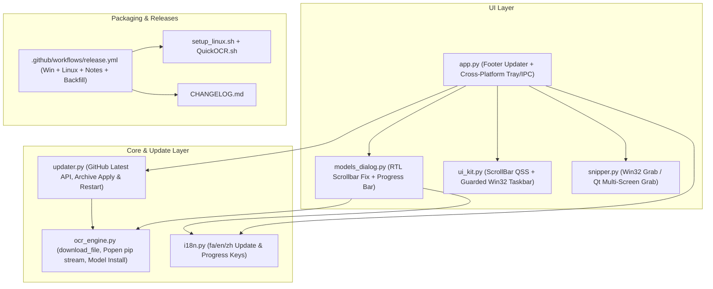

# QuickOCR v1.1.0 Implementation Plan

> **For agentic workers:** Implement task-by-task using TDD (Red -> Green -> Verify). Keep code minimal (YAGNI/DRY), preserve pure-black OLED styling, and verify UI visually before release.

**Goal:** Deliver Model Manager progress/scrollbar/pip fixes, an in-app GitHub auto-updater footer, full Linux support + CI `.tar.gz` release builds, and structured release notes with prior-release backfill (`v1.0.0`–`v1.0.3`).

**Architecture:** Extract shared chunked download/progress helpers into `ocr_engine.py`, isolate update version comparison/downloading/staging into `updater.py`, guard Windows calls and add Qt screen capture + XDG autostart/desktop integration for Linux, and automate multi-OS GitHub releases + changelog extraction in `.github/workflows/release.yml`.

**Architecture Diagram:**

**Tech Stack:** Python 3.11+, PySide6-Essentials, Pillow, LiteParse (`ocria-nano`), `urllib.request`, `zipfile`/`tarfile`, PowerShell/Bash, GitHub Actions.

**Spec:** `docs/superpowers/specs/2026-11-25-updater-linux-models-design.md`

## Global Constraints
- Python 3.11 runtime compatibility on both Windows (`D:\app\QuickOCR\runtime\python.exe` non-MSIX host + `.venv`) and Linux (`ubuntu-latest` Python 3.11 + `xvfb`).
- Pure-black `#000000` OLED aesthetic with Vazirmatn (`fa` RTL), Segoe UI (`en`), and Microsoft YaHei UI (`zh`).
- Keep `config.json`, `.venv/`, and user-downloaded `models/` untouched across self-updates.
- No invented CLI flags or unverified APIs; reuse `ocr_engine.download_file` across Tesseract, model files, and GitHub updates.

---

### Task 1: Translations for Progress Bar, Updater & Linux Fallback (`i18n.py`)
**Files:**
- Modify: `i18n.py`
**Interfaces:**
- Produces trilingual keys: `lbl_update_idle`, `btn_check_update`, `btn_install_update`, `msg_checking_update`, `msg_up_to_date`, `msg_update_avail`, `msg_update_downloading`, `msg_update_applying`, `msg_update_err`, `msg_install_pct`, `msg_pip_stage`, `msg_weights_stage`, `msg_linux_hotkey_hint`.
- [ ] Add failing assertion in `check_ocr.py` verifying all new i18n keys exist across `("fa", "en", "zh")`.
- [ ] Run `check_ocr.py` to confirm Red failure on missing keys.
- [ ] Add keys cleanly in `i18n.py` for `fa`, `en`, `zh`.
- [ ] Re-run `check_ocr.py` to confirm Green.

### Task 2: Model Manager Download Reliability, Live Progress & RTL Scrollbar Fix (`ocr_engine.py`, `models_dialog.py`, `ui_kit.py`)
**Files:**
- Modify: `ocr_engine.py`, `models_dialog.py`, `ui_kit.py`, `check_ocr.py`
**Interfaces:**
- Produces `ocr_engine.download_file(url, dest, on_progress=None, timeout=120.0)`, `ocr_engine.install_model(model_id, on_progress=None)`, `ProgressCallback = Callable[[int, str], None]`.
- Consumes new progress/error signals on `_WorkerSignals.progress = Signal(int, str)` in `ModelsView`.
- [ ] Write failing unit check in `check_ocr.py`: test `_run_pip` failure surfaces real stderr (mocked or invalid package check / unit function `_extract_pip_error`), progress callback behavior on `download_file`, and symmetric `ModelsView` scroll body margins (`left == right >= 10`) + `progress_bar` visibility states.
- [ ] Verify failure first (Red).
- [ ] Implement `download_file`, streaming `_run_pip` (`--timeout 180 --retries 5 --no-input --progress-bar off`), folder byte-growth monitor for weight stages, `on_progress` support in `install_model`, RTL scrollbar fix + bottom `status_frame` with sleek monochrome `QProgressBar` in `models_dialog.py` & `ui_kit.py`.
- [ ] Run `check_ocr.py` (Green) and render PNG preview inspecting RTL scrollbar clearance and progress bar layout.

### Task 3: GitHub Self-Updater Module & Footer Section (`updater.py`, `app.py`)
**Files:**
- Create: `updater.py`
- Modify: `app.py`, `check_ocr.py`
**Interfaces:**
- Produces: `APP_VERSION = "1.1.0"`, `ReleaseInfo`, `parse_version`, `is_newer_version`, `select_release_asset`, `check_latest_release`, `download_and_apply_update`.
- Consumes `ocr_engine.download_file`.
- [ ] Write failing assertions in `check_ocr.py` covering `parse_version("v1.1.0") > parse_version("v1.0.3")`, `select_release_asset` for `"win32"` vs `"linux"`, archive extraction preserving `config.json`/`models/`, and footer `update_btn` + `ver_lbl` visibility & RTL layout inside `QuickOCRWindow`.
- [ ] Verify failure first (Red).
- [ ] Implement `updater.py` (using stdlib `json`, `tarfile`, `zipfile`, `shutil`, `subprocess`) and wire bottom update row inside `footer_wrap` in `app.py` (plus silent 1.5s startup background check and 1-click download/install + restart).
- [ ] Run `check_ocr.py` (Green) and visually inspect main window footer screenshot.

### Task 4: Full Linux Cross-Platform Support & Shell Installers (`app.py`, `snipper.py`, `ui_kit.py`, `ocr_engine.py`, `setup_linux.sh`, `QuickOCR.sh`)
**Files:**
- Modify: `app.py`, `snipper.py`, `ui_kit.py`, `ocr_engine.py`, `check_ocr.py`
- Create: `setup_linux.sh`, `QuickOCR.sh`
**Interfaces:**
- `snipper.get_virtual_screen_bounds()` & `_capture_virtual_screen()` work cleanly on Windows (`ctypes.windll.user32` / `ImageGrab`) and non-Windows (`QGuiApplication.screens()` + `grabWindow(0)`).
- `app.py` supports `--snip` CLI + `"SNIP"` IPC command, `xdg-open` folder, `QApplication.beep()` sound, XDG `~/.config/autostart/quickocr.desktop`.
- [ ] Write tests in `check_ocr.py` exercising Qt screen capture fallback (`_capture_qt_virtual_screen`) and platform-independent autostart path helper.
- [ ] Verify failure (Red).
- [ ] Implement cross-platform guards & helpers + `setup_linux.sh` and `QuickOCR.sh`.
- [ ] Run `check_ocr.py` (Green).

### Task 5: `CHANGELOG.md`, Multi-OS CI Release Workflow & Prior Release Notes Backfill (`.github/workflows/release.yml`, `CHANGELOG.md`, `README.md`)
**Files:**
- Create: `CHANGELOG.md`
- Modify: `.github/workflows/release.yml`, `README.md`
**Interfaces:**
- Tag pushes (`v*`) build BOTH `QuickOCR-$tag-Windows.zip` and `QuickOCR-$tag-Linux.tar.gz`, run `check_ocr.py` on Windows and Linux (`xvfb-run`), extract the tag section from `CHANGELOG.md` for release notes, and publish both artifacts.
- `workflow_dispatch` job (`backfill_notes`) updates release notes on existing tags (`v1.0.0`, `v1.0.1`, `v1.0.2`, `v1.0.3`).
- [ ] Write `CHANGELOG.md` with clear, accurate feature lists for `v1.0.0`, `v1.0.1`, `v1.0.2`, `v1.0.3`, and `v1.1.0`.
- [ ] Update `.github/workflows/release.yml` and validate YAML + changelog extraction script locally against every version `v1.0.0`–`v1.1.0`.
- [ ] Update `README.md` documenting Auto-Updater, Linux installation (`setup_linux.sh` / `.tar.gz`), download progress UI, and `v1.1.0`.
- [ ] Run full `check_ocr.py` + visual screenshot checks (`main`, `models_rec`, `models_progress`, `models_api`), commit, push `main`, run backfill workflow, tag `v1.1.0`, push tag, and verify both Windows + Linux release assets and filled release notes on GitHub!
